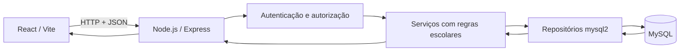
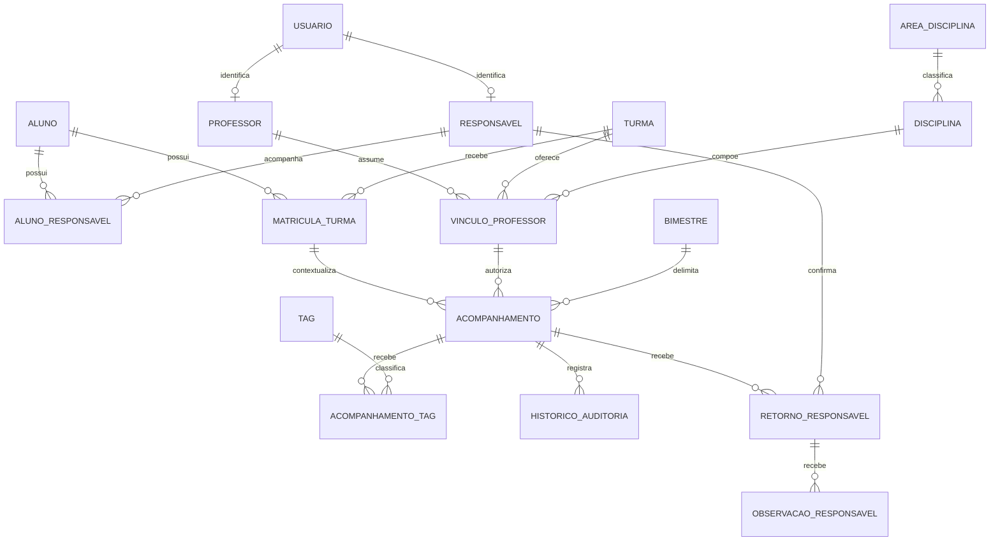
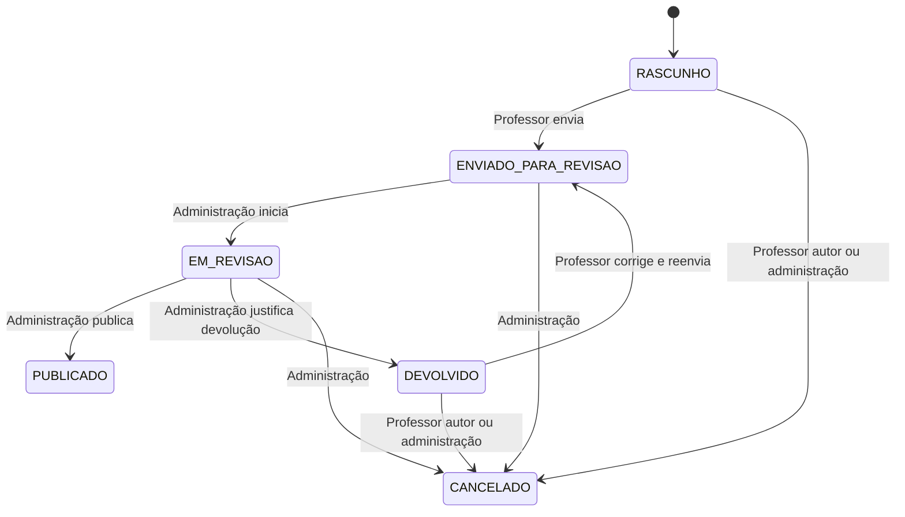

# Modelagem do backend Collision — Fullstack

Status: referência de modelagem usada na implementação Fullstack. A situação atual,
os comandos de execução e os limites estão em README.md. A API foi implementada
em Express/MySQL. As áreas React consultam a API com a sessão do usuário.

## 1. Decisão de arquitetura

A aplicação principal será React/Vite + Node.js/Express + MySQL. A prioridade de
Fullstack foi confirmada pelo usuário. O projeto C# em `documentos/Entrega 2/POO`
continua como entrega de POO e referência de regras; não será uma dependência para
executar o site. Não haverá sincronização entre o SQLite desse projeto e o MySQL.

Uma única API, organizada por módulos, é suficiente para o escopo escolar.
O frontend envia requisições HTTP; o Express valida a identidade e os dados;
os serviços aplicam as regras; os repositórios consultam e alteram o MySQL.



Tecnologias: JavaScript com módulos ES, Express, `mysql2/promise`, `bcryptjs`
e `jsonwebtoken`. Usar pool de conexões, SQL parametrizado e variáveis de ambiente.
`VITE_API_URL` contém somente o endereço público da API. Senhas do banco e segredo
JWT ficam exclusivamente nas variáveis do servidor, nunca em variáveis `VITE_*`.

## 2. Evidências consultadas

- `C:/Users/lucas/Downloads/Documentos/pi.pdf`, 9 páginas: regras nas páginas 2–3,
  requisitos técnicos na página 4, cenário de aceite na página 5 e entrega
  Fullstack na página 6. A API precisa de persistência, autenticação, validação,
  tratamento de erros e integração publicada com o frontend.
- Conteúdo das aulas 09–12 enviado pelo usuário: Express em memória, MySQL,
  JWT/bcrypt e integração React com `VITE_API_URL`.
- `documentos/Entrega 2/Banco de Dados/Codigo_versao_Mysql.sql`: 14 tabelas e
  5 views já modeladas. É o ponto de partida; não foi alterado nesta análise.
- `documentos/Entrega 2/Banco de Dados/Código_com_as_VIEWS.sql`: versão com
  sintaxe Oracle; não usar como script de instalação MySQL.
- `src/Entrega 2/Frontend/src/hooks/useAdminDemo.jsx`: cadastros e prazos em memória.
- `src/Entrega 2/Frontend/src/hooks/useFluxoAdmin.jsx`: acompanhamento, revisão,
  publicação, ciência e observações em memória.
- `src/Entrega 2/Frontend/src/paginas/login.jsx`: validação local e abertura do
  seletor de perfis; ainda não autentica no servidor.
- `documentos/Entrega 2/POO/KFKA-POO`: código C# existente, inspecionado como
  referência de domínio. A API C# não foi executada nesta análise.

O material das aulas usa lugares e avaliações para ensinar a técnica. O domínio
desta API será escola, alunos e acompanhamentos, conforme o PI.

## 3. Modelo de dados

### Estruturas existentes que serão aproveitadas

| Tabela              | Responsabilidade e relação                                              |
| ------------------- | ----------------------------------------------------------------------- |
| USUARIO             | Identidade, nome, email único, senha_hash, perfil e situação ativa.     |
| PROFESSOR           | Dados próprios do professor; um usuário por professor.                  |
| RESPONSAVEL         | Dados próprios do responsável; um usuário por responsável.              |
| ALUNO               | Identidade escolar e matrícula única. Aluno não recebe login neste MVP. |
| TURMA               | Turma de um ano letivo; nome + ano não se repetem.                      |
| DISCIPLINA          | Disciplina vinculada a uma área de conhecimento.                        |
| ALUNO_RESPONSAVEL   | Relação N:N: um aluno pode ter vários responsáveis e vice-versa.        |
| VINCULO_PROFESSOR   | Professor + turma + disciplina + ano, com chave única existente.        |
| BIMESTRE            | Número 1–4 e ano letivo, abertura e encerramento.                       |
| TAG                 | Classificações cadastradas pela administração.                          |
| ACOMPANHAMENTO      | Aluno + vínculo docente + bimestre, conteúdo, média e situação.         |
| ACOMPANHAMENTO_TAG  | Relação N:N entre acompanhamentos e tags.                               |
| HISTORICO_AUDITORIA | Quem realizou a ação, quando e o que mudou.                             |
| RETORNO_RESPONSAVEL | Ciência de um responsável sobre um acompanhamento.                      |

### Ajustes propostos antes da API de produção

| Necessidade            | Proposta e motivo                                                                                                                                                                                                                             |
| ---------------------- | --------------------------------------------------------------------------------------------------------------------------------------------------------------------------------------------------------------------------------------------- |
| Cadastro de áreas      | Criar AREA_DISCIPLINA(id_area, nome único, descricao, ativo) e DISCIPLINA.id_area como FK. Hoje `area` é texto livre. Migrar os nomes existentes antes de remover a coluna antiga.                                                            |
| Data e hora dos prazos | BIMESTRE.dt_abertura e dt_encerramento passam de DATE para DATETIME, com abertura anterior ao encerramento. A API recebe ISO 8601 com fuso e persiste UTC. Não inventar horários ao migrar datas existentes: a administração deve defini-los. |
| Conteúdo das telas     | ACOMPANHAMENTO mantém descricao; acrescentar estrategias e ajuda_familia opcionais, motivo_devolucao, id_revisor, publicado_em e versao. `desenvolvimento` do React corresponde a `descricao`.                                                |
| Histórico completo     | HISTORICO_AUDITORIA recebe acao, entidade, entidade_id, antes_json e depois_json. id_acompanhamento pode ser nulo para auditar tags, prazos e cadastros. Registrar somente campos necessários, nunca senha ou token.                          |
| Leitura individual     | RETORNO_RESPONSAVEL deve ter UNIQUE(id_acompanhamento, id_responsavel). Repetir a confirmação não cria outro retorno e preserva a primeira data de ciência.                                                                                   |
| Várias observações     | Criar OBSERVACAO_RESPONSAVEL(id_observacao, id_retorno, texto, criado_em). Uma ciência pode ter várias observações; cada mensagem mantém autor através do retorno. Migrar observações antigas antes de descontinuar o campo único.            |
| Histórico de turmas    | Criar MATRICULA_TURMA(id_matricula_turma, id_aluno, id_turma, inicio_em, fim_em). Acompanhamento referencia a matrícula pertinente, além do vínculo docente. Evita perder o contexto ao transferir aluno.                                     |
| Logout e sessão        | Criar SESSAO(id_sessao, id_usuario, expira_em, revogada_em). O JWT contém o identificador da sessão; o middleware confere sessão e usuário ativos. Logout revoga a sessão.                                                                    |
| Recuperação de senha   | Criar RECUPERACAO_SENHA(id, id_usuario, token_hash, expira_em, usado_em). Token aleatório de uso único; guardar apenas hash. Resetar a senha também revoga sessões anteriores.                                                                |

Na matrícula, impedir duas matrículas vigentes ao mesmo tempo para o mesmo aluno:
travar o aluno na transação e validar intervalos. As FKs isoladas não garantem que
a matrícula, o vínculo e o bimestre pertençam à mesma turma e ao mesmo ano. O
serviço valida essas relações antes de gravar. Datas antigas não devem ser
reconstruídas sem fonte: a migração do histórico exige conferência dos dados reais.

Conservar `UNIQUE(id_aluno, id_vinculo, id_bimestre)` do acompanhamento: evita repetir
o registro para a mesma atribuição docente. Não impor silenciosamente um único
professor por turma/disciplina, pois o documento não proíbe docência compartilhada.

O usuário tem um perfil por conta nesta primeira versão, conforme o SQL existente.
A necessidade de uma pessoa acumular perfis poderá evoluir para USUARIO_PERFIL;
o seletor demonstrativo do frontend não concede papéis na aplicação real.

Cadastros usados em históricos serão inativados. Não oferecer exclusão física de
alunos, usuários ou acompanhamentos já referenciados. Revisar os ON DELETE CASCADE
existentes antes de habilitar qualquer endpoint de exclusão.

### Relações centrais propostas



Esse diagrama destaca o domínio escolar, não todas as colunas ou relações técnicas.
Os arquivos de migração serão separados do SQL original e executados somente após
conferência da base instalada, backup e validação em banco de teste.

### Views e indicadores

As cinco views existentes podem servir como base de leitura. Ajustes necessários:

- VW_RELATORIO_PUBLICADO usa data_atualizacao como data_publicacao. Trocar pelo
  campo publicado_em, pois uma atualização não representa necessariamente publicação.
- VW_RELATORIO_RESPONSAVEL já relaciona responsável e aluno. Toda consulta da API
  deve incluir o usuário autenticado; uma view não autoriza o acesso por si só.
- Adaptar a view de ciência após garantir um retorno por responsável/registro.
- Para filtros com tags e responsáveis, usar EXISTS ou agregação prévia para não
  multiplicar acompanhamentos e inflar contagens em relações N:N.
- PDF, listas, indicadores e exportações devem compartilhar as mesmas regras de
  acesso e filtros. Paginação limita a lista, não o total da exportação autorizada.

## 4. Regra central: fluxo editorial



Salvar um rascunho mantém RASCUNHO; salvar uma correção mantém DEVOLVIDO.
Não aceitar `status`, `id_professor`, `id_responsavel` ou `id_revisor` arbitrários no
corpo de uma edição. O servidor deriva autoria da identidade autenticada e muda o
estado apenas por ações autorizadas.

Regras obrigatórias do documento:

1. Professor ativo, vínculo válido, aluno da turma e ano compatível.
2. Criação, edição e envio do professor dentro do prazo configurado, usando relógio
   real do servidor. O relógio fixo do protótipo serve apenas a testes.
3. Família acessa apenas PUBLICADO e apenas alunos com vínculo autorizado ativo.
4. Alterações administrativas e publicação registram usuário, instante e antes/depois.
5. Média respeita a escala da escola; a proposta inicial é 0 a 10, como o SQL e a UI.

Decisões propostas para completar o comportamento (não são todas regras explícitas do PDF):

- Rascunho pode ficar incompleto. Envio exige descrição, média e ao menos uma tag,
  compatível com o comportamento atual da UI. O PDF permite múltiplas tags, mas não
  determina explicitamente o mínimo; essa política deve ficar documentada.
- Justificativa obrigatória para devolução e edição administrativa.
- Conteúdo publicado fica imutável no MVP. Retificação/republicação exigirá fluxo
  próprio e ciência por versão; não reutilizar a ciência antiga para conteúdo novo.
- Cancelamento é lógico e preserva histórico. Cancelar um registro publicado fica
  fora desse fluxo inicial, pois o enunciado não define como avisar a família.
- Observação exige ciência prévia, com limite inicial de 2.000 caracteres, como a UI.
- Administrador pode revisar após o fechamento; o prazo limita a digitação docente.

Cada mudança salva acompanhamento, tags e auditoria na mesma transação. Usar uma
conexão retirada do pool para BEGIN, consultas, COMMIT/ROLLBACK e release. Validar
versao e situação atual sob trava para impedir duas decisões concorrentes; conflito
retorna HTTP 409 e a tela pede atualização dos dados.

## 5. Autenticação e permissões

| Perfil        | Pode acessar                                                                         |
| ------------- | ------------------------------------------------------------------------------------ |
| Administrador | Cadastros, vínculos, prazos, revisão, auditoria, relatórios e exportação.            |
| Professor     | Suas atribuições, alunos dessas turmas, seus acompanhamentos e retornos pertinentes. |
| Responsável   | Seus alunos vinculados, relatórios publicados, ciência, observação e PDF.            |

Cadastro de usuários pelo administrador, sem registro público que permita escolher
ADMINISTRADOR. Criar o primeiro administrador por comando de bootstrap com dados
recebidos do ambiente. A operação satisfaz o cadastro de contas da entrega sem abrir
acesso administrativo ao público. Ativação por convite pode ser adicionada depois.

Login compara bcrypt e emite JWT com expiração, sub e identificador de sessão.
Verificar assinatura, algoritmo permitido, emissor, destinatário e expiração; não
usar decode como autenticação. O middleware consulta a situação atual do usuário
e da sessão, permitindo inativação e logout efetivos. Guardar o token de acesso em
memória no React nesta versão; recarregar exige novo login. Persistência de sessão
com refresh token seria uma evolução, com desenho próprio de cookies/CSRF.

Limitar tentativas de login e recuperação. Não retornar hash, senha, token de
recuperação ou erro SQL ao cliente. A recuperação responde de forma genérica,
independentemente da existência do email. O envio real exige um serviço de email
configurado; modo de desenvolvimento não deve anunciar entrega real.

## 6. Organização proposta dos arquivos

```text
Backend/
  package.json
  .env.example
  .gitignore
  src/
    app.js                    # configura Express, JSON, CORS, rotas e erros
    servidor.js               # abre a porta HTTP e encerra conexões corretamente
    config/ambiente.js        # valida configurações obrigatórias
    banco/pool.js             # conecta ao MySQL
    rotas/                    # URL, método e middlewares
    controladores/            # lê entrada validada e escreve resposta HTTP
    servicos/                 # regras e transações
    repositorios/             # SQL parametrizado
    validadores/              # formatos, campos permitidos e limites
    middlewares/              # autenticação, perfil, erros e rota inexistente
    documentos/               # PDF e exportação
  sql/migracoes/              # evolução versionada a partir do esquema conferido
  scripts/                   # bootstrap e carga fictícia de demonstração
  testes/                    # domínio, HTTP, permissões e MySQL de teste
```

Exemplo: `rotas/acompanhamentos.js` recebe a chamada; o controlador extrai os
campos validados; `servicos/acompanhamentoServico.js` verifica autor, prazo e estado;
`repositorios/acompanhamentoRepositorio.js` executa o SQL. Regras não ficam espalhadas
pelas rotas ou dependentes de botões escondidos no React.

## 7. Contrato inicial da API

Prefixo `/api`. A organização é por recursos, sem criar uma rota de servidor para
cada tela de confirmação do Figma. As respostas permitem à UI escolher a próxima tela.

| Método e caminho                                                             | Ação                                      | Permissão                                            |
| ---------------------------------------------------------------------------- | ----------------------------------------- | ---------------------------------------------------- |
| POST /auth/login                                                             | Autenticar e emitir token                 | Público, com limite de tentativas                    |
| GET /auth/me                                                                 | Identidade e perfil atuais                | Autenticado                                          |
| POST /auth/logout                                                            | Revogar sessão atual                      | Autenticado                                          |
| POST /auth/recuperacao                                                       | Solicitar recuperação                     | Público, resposta genérica                           |
| POST /auth/redefinicao                                                       | Consumir token e trocar senha             | Token válido de uso único                            |
| GET, POST /usuarios                                                          | Listar/criar contas                       | Administrador                                        |
| GET, PATCH /usuarios/:id                                                     | Detalhar/editar/inativar                  | Administrador                                        |
| GET, POST /alunos, /turmas, /areas, /disciplinas, /tags                      | Cadastros                                 | Escrita administrativa; leituras filtradas por papel |
| GET, PATCH /alunos/:id, /turmas/:id, /areas/:id, /disciplinas/:id, /tags/:id | Detalhes e manutenção                     | Escrita administrativa; leituras autorizadas         |
| GET, POST /vinculos/professores                                              | Atribuições docentes                      | Administrador; professor consulta as próprias        |
| PATCH /vinculos/professores/:id                                              | Encerrar atribuição sem apagar histórico  | Administrador                                        |
| GET, POST /vinculos/responsaveis                                             | Vínculos familiares                       | Administrador; responsável consulta os próprios      |
| PATCH /vinculos/responsaveis/:alunoId/:responsavelId                         | Inativar/atualizar vínculo                | Administrador                                        |
| POST /matriculas                                                             | Matricular ou transferir em transação     | Administrador                                        |
| GET /bimestres                                                               | Consultar períodos do ano                 | Autenticado                                          |
| POST /bimestres/ano                                                          | Criar os quatro períodos de um ano        | Administrador                                        |
| PATCH /bimestres/:id                                                         | Configurar abertura/encerramento          | Administrador                                        |
| GET /acompanhamentos                                                         | Listar com filtros e paginação            | Recorte autorizado do perfil                         |
| GET /acompanhamentos/:id                                                     | Detalhar registro autorizado              | Recorte autorizado do perfil                         |
| POST /acompanhamentos                                                        | Criar rascunho                            | Professor vinculado                                  |
| PATCH /acompanhamentos/:id                                                   | Salvar conteúdo permitido                 | Professor autor ou administrador em revisão          |
| POST /acompanhamentos/:id/enviar                                             | Enviar ou reenviar                        | Professor autor e prazo aberto                       |
| POST /acompanhamentos/:id/iniciar-revisao                                    | Iniciar revisão                           | Administrador                                        |
| POST /acompanhamentos/:id/devolver                                           | Devolver com motivo                       | Administrador                                        |
| POST /acompanhamentos/:id/publicar                                           | Publicar conteúdo                         | Administrador                                        |
| POST /acompanhamentos/:id/cancelar                                           | Cancelar conforme estado                  | Professor autor ou administrador                     |
| GET /acompanhamentos/:id/historico                                           | Histórico interno                         | Professor autorizado ou administrador                |
| PUT /acompanhamentos/:id/ciencia                                             | Registrar a primeira ciência, idempotente | Responsável vinculado                                |
| POST /acompanhamentos/:id/observacoes                                        | Criar observação                          | Responsável vinculado                                |
| GET /acompanhamentos/:id/pdf                                                 | Baixar conteúdo publicado                 | Responsável vinculado; acesso escolar autorizado     |
| GET /meus-alunos                                                             | Alunos vinculados à família ou ao docente | Responsável ou professor                             |
| GET /retornos                                                                | Leituras e observações autorizadas        | Professor ou administrador                           |
| GET /relatorios/indicadores                                                  | Agregações do recorte autorizado          | Professor ou administrador                           |
| GET /relatorios/exportacao                                                   | CSV/XLSX do conjunto filtrado             | Administrador                                        |
| GET /auditoria                                                               | Eventos com filtros                       | Administrador                                        |

PUT de ciência representa um único recurso por responsável e acompanhamento. O
curso ensina GET/POST/PATCH/DELETE; a API pode usar PUT onde a repetição deve manter
o mesmo resultado. DELETE não é obrigatório para todas as entidades: a inativação
via PATCH atende à preservação do histórico escolar.

Convenções: JSON em camelCase; IDs do banco estáveis, sem nomes como identificador;
datas ISO 8601; enums técnicos em maiúsculas e rótulos traduzidos no React. Para
listas, `{ dados: [], paginacao: { pagina, limite, total } }`, com limite máximo 100
e ordenação permitida por lista explícita. Filtros jamais ampliam o acesso do perfil.

Exemplo de criação de rascunho:

```http
POST /api/acompanhamentos
Authorization: Bearer <token-do-professor>
Content-Type: application/json

{
  "alunoId": 1,
  "vinculoId": 3,
  "bimestreId": 4,
  "descricao": "Apresentou avanços na resolução de problemas.",
  "estrategias": "Revisão orientada das atividades.",
  "media": 8.7,
  "tagIds": [1, 3]
}
```

Resposta 201 com ID, situação RASCUNHO e versao. Nota numérica usa ponto no JSON;
o React continua exibindo vírgula. Normalizar DECIMAL do mysql2 no DTO de saída.

Erros: 400 entrada inválida; 401 credencial/token ausente ou inválido; 403 ação
proibida; 404 inexistente ou fora do recorte de leitura; 409 duplicidade, período
fechado, estado incompatível ou versão desatualizada; 429 limite de tentativas;
500 erro interno com mensagem genérica. Sucessos: 200 consulta/edição, 201 criação,
204 logout/inativação quando não houver corpo.

```json
{
  "erro": {
    "codigo": "PERIODO_ENCERRADO",
    "mensagem": "O período de digitação deste bimestre está encerrado.",
    "campos": {}
  }
}
```

## 8. Integração com o frontend existente

| Hoje                                       | Mudança necessária                                                                           |
| ------------------------------------------ | -------------------------------------------------------------------------------------------- |
| Login valida campos e abre escolher-perfil | Login chama API e direciona conforme o perfil autenticado.                                   |
| useAdminDemo mantém cadastros/períodos     | Serviços HTTP carregam dados e persistem alterações.                                         |
| useFluxoAdmin muda estado local            | Serviços HTTP chamam as ações e atualizam a tela após resposta.                              |
| professoraDemo e responsavelDemo fixos     | GET /auth/me define identidade e permissões.                                                 |
| bimestre com relógio fixo                  | Servidor decide abertura com relógio real.                                                   |
| cienciaEm diretamente no registro          | DTO calcula ciência para o responsável atual; administração recebe situação por responsável. |
| filtros e paginação em arrays              | API filtra e pagina; UI preserva apenas filtros, seleção e rascunhos de formulário.          |
| PDF/CSV/XLSX gerados da base demonstrativa | Rotas autenticadas geram arquivos a partir dos dados autorizados e persistidos.              |

Criar `src/servicos/api.js`, `servicoAuth.js`, `servicoCadastros.js`,
`servicoAcompanhamentos.js` e `servicoRelatorios.js` no frontend. Centralizar
`fetch`, URL base, Bearer token e leitura dos erros. Tratar loading, vazio, erro,
401 e 409 nas telas. CORS libera apenas as origens configuradas; autorização
continua sendo verificada na API.

Não importar todos os arrays demonstrativos como carga do banco: alguns exemplos
foram multiplicados para ilustrar contagens e podem repetir a chave de negócio.
A carga de demonstração precisa de IDs, vínculos, perfis e acompanhamentos coerentes.

## 9. Limites do MVP e telas adicionais

RF01–RF11 e ciência de RF12 formam o núcleo; observações já foram adotadas na UI.
Comunicados aparecem no Figma implementado, mas um mural de comunicados não está
explicitamente entre os requisitos centrais do PDF. Para persistir esse recurso,
adicionar COMUNICADO e COMUNICADO_TURMA, com autor administrativo, publicação e
destinatários por turma; consultas continuam limitadas à família vinculada.

Frequência e quantidade de atividades nas telas são ilustrativas. O documento
não define lançamento de presença ou de tarefas. Na primeira integração, omitir
esses indicadores ou indicar ausência de dados; não gravar números fictícios como
se fossem calculados. Relatórios escolares e média por acompanhamento já têm fonte.

Média global precisa de regra pedagógica: média simples das disciplinas não deve
ser apresentada como média oficial sem definição de pesos e recorte. Os relatórios
podem expor inicialmente as médias dos acompanhamentos por disciplina/bimestre.

## 10. Sequência de implementação alinhada às aulas

1. **Fundação (aula 09):** Express, GET /api/saude, JSON, rotas, validadores e
   tratamento de erro. Arrays somente como exercício isolado ou doubles de teste.
2. **Persistência (aula 10):** conferir MySQL, preparar migrações, pool,
   repositórios e carga fictícia; criar/listar/detalhar um cadastro real.
3. **Identidade (aula 11):** bootstrap, cadastro administrativo, bcrypt, JWT,
   sessão, login/logout e permissões. Proteger as escritas antes de expor a API.
4. **Cadastros:** alunos, responsáveis, professores, áreas, disciplinas, turmas,
   vínculos, tags e quatro períodos por ano.
5. **Fluxo principal:** rascunho, envio, revisão, devolução, publicação e auditoria
   transacional. Consultas do responsável, ciência e observação.
6. **Integração (aula 12):** migrar o React por fluxo, começando por login e
   cadastros, depois professor/admin/família. Gerar PDF e exportações reais.
7. **Entrega:** testes com dois usuários de cada perfil, MySQL real de teste,
   documentação, backup/restauração e deploy conjunto com configuração de ambiente.

O MVP de aceite segue a página 5: administrador prepara a escola e abre o bimestre;
professor envia; administrador revisa/publica; responsável consulta e baixa PDF;
administrador exporta para Excel. Banco, autenticação e integração são partes da
entrega Fullstack, não uma etapa opcional posterior.

## 11. Verificação prevista

- Reiniciar a API e confirmar que os cadastros permanecem no MySQL.
- Login correto/incorreto, conta inativa, sessão expirada e logout efetivo.
- Professor não acessa atribuição alheia nem edita fora do período.
- Família não consulta outro aluno, rascunho, histórico interno ou PDF não publicado.
- Dois responsáveis pelo mesmo aluno mantêm ciências independentes.
- Repetir ciência não duplica registro; observação vazia é rejeitada.
- Rascunho duplicado retorna 409; envio incompleto retorna 400.
- Duas publicações concorrentes não geram dois eventos nem sobrescrevem versão.
- Falha durante auditoria desfaz a alteração inteira da transação.
- Mudança de turma não reescreve o contexto de relatórios antigos.
- Totais não são multiplicados por tags ou responsáveis; exportação respeita filtros.
- PDF usa dados publicados do aluno autorizado, com acentos e paginação legíveis.

Situação do ambiente nesta análise: Node v24.18.0 disponível. A consulta aos
serviços do Windows foi bloqueada pelo ambiente, portanto instalação e conexão
MySQL não foram confirmadas. Nenhuma credencial de banco foi solicitada ou exposta.

## 12. Referências técnicas

- Express, rotas: https://expressjs.com/en/guide/routing/
- mysql2, promises, pool e consultas parametrizadas: https://sidorares.github.io/node-mysql2/docs
- jsonwebtoken, assinatura/verificação e expiração: https://github.com/auth0/node-jsonwebtoken
- bcryptjs, hash e comparação: https://github.com/dcodeIO/bcrypt.js

As páginas oficiais foram consultadas para apoiar a arquitetura. O link do
enunciado da aula 10 não ficou acessível pela ferramenta de navegação; o conteúdo
das aulas fornecido pelo usuário foi suficiente para este alinhamento.
